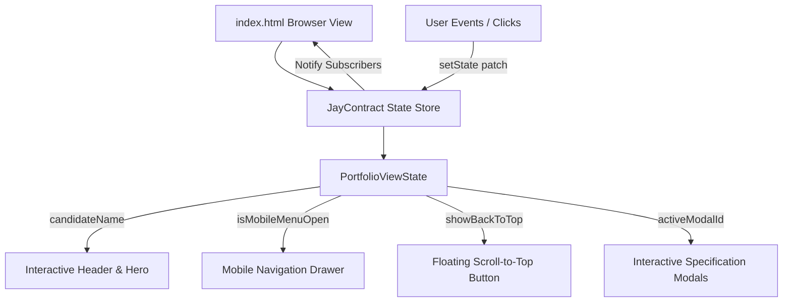

# Modern Technical Business Analyst Portfolio

[](tests/)
[](design-log/)
[](https://tailwindcss.com/)
[](LICENSE)

> **Portfolio of Nguyen Huu Hoang Pho**  
> *Business Analyst Intern*  
> 📍 **Location**: Danang, Vietnam  
> 📞 **Phone**: [0379876301](tel:0379876301)  
> 📧 **Direct Contact**: [hoangpho.2212@gmail.com](https://mail.google.com/mail/?view=cm&fs=1&to=hoangpho.2212@gmail.com)  
> 🌐 **Live Portfolio**: [portfolio-ba-gamma.vercel.app](https://portfolio-ba-gamma.vercel.app)

---

## 🌟 Executive Overview

This repository houses the personal portfolio website of **Nguyen Huu Hoang Pho**, an analytical and technically-driven Business Analyst Intern with a solid engineering foundation in full-stack software development, desktop architecture, and automated data workflows.

Unlike traditional non-technical analysts, this profile bridges the gap between high-level business stakeholder requirements and low-level code implementation, turning ambiguous requirements into structured SRS documents, UML models, database schemas, and API gateway routing rules.

---

## 🧭 Live Preview & Quickstart

The portfolio is built as a zero-dependency, self-contained single-page application using modern HTML5, Tailwind CSS, and vanilla JavaScript.

### Option 1: Direct File Open
Simply open `index.html` in any modern web browser:
- On Windows: Double-click `index.html` or run:
  ```powershell
  Start-Process index.html
  ```

### Option 2: Local HTTP Server
```bash
# Using Python
python -m http.server 8080

# Or using Node npx serve
npx serve .
```
Navigate to `http://localhost:8080` in your browser.

---

## 🎓 Academic Background & Education

- **Degree**: Bachelor of Software Engineering
- **University**: University of Greenwich
- **Expected Graduation**: 2027
- **Degree Classification**: Upper Second-Class Honours (2:1)
- **Academic Grade**: 69/100 (1pt below First-Class threshold)

---

## 💼 Core Competencies & Skills Matrix

The portfolio is structured around the four competency groups specified in the candidate's official CV:

| Domain Group | Core Skills & Methodologies | Tools & Technologies |
| :--- | :--- | :--- |
| **BA & Agile Methodologies** | Requirements Gathering (SRS), Use Case & Class Modeling, Workflow Design, Jira Sprint Planning, Agile/Scrum. | Jira, Confluence, UML, SRS, BRD, SAD |
| **Data & System Integration** | Database Schema Design (MongoDB, MySQL), ETL Workflows, Microsoft Power Automate, API Gateway Configuration (Ocelot). | MongoDB, MySQL, Microsoft Power Automate, Ocelot Gateway |
| **Testing & QA** | Input Validation Matrices, Test Case Design, System Diagnostics, xUnit, Manual Testing. | xUnit, Manual QA, RegEx Constraints, TC1-TC9 Matrices |
| **Languages & Communication** | English (B2 Level), Vietnamese (Native), Bilingual Specification Writing, Stakeholder Alignment. | Cross-functional alignment, executive presentation |

---

## 🏆 Leadership & Organizational Impact

- **Role**: Chairman of the Greenwich Football Club (Gre FC)
- **Impact & Governance**:
  - **Strategic Leadership & Management**: Directed core club operations, coordinated cross-functional volunteer committees, and unified diverse student cohorts to execute competitive athletic events.
  - **Stakeholder Negotiation & Tournament Logistics**: Directed the end-to-end event logistics for an 8-team competitive university championship; successfully negotiated custom structural regulations (including home-half back-pass rule allowances) directly with the leadership board.
  - **Cross-Functional Communication**: Bridged operational gaps between technical, operational, and non-technical stakeholders, translating complex logistical and rule constraints into clear, structured schedules across multi-day tournament fixtures.

---

## 🚀 Key Project Cases

### 1. AptisGo Exam Preparation Platform
- **Tech Stack**: MongoDB | Jira | UML
- **BA Focus & Requirements**:
  - Produced comprehensive system documentation including Business Requirements Document (BRD), Software Requirements Specification (SRS), System Architecture Document (SAD), and User Stories.
  - Designed system architecture utilizing Class/ERD diagrams and C4 models.
  - Managed Agile sprint schedules via Jira.
- **System Implementation**:
  - Engineered a robust web application for Aptis exam preparation featuring an automated grading system for the listening section.
  - Implemented flexible NoSQL data storage solutions using MongoDB to accommodate complex, dynamic exam structures.

### 2. Desktop Information System for Education Centre
- **Tech Stack**: C#.NET Windows Forms | MySQL
- **BA Focus & SRS**:
  - Authored an end-to-end Software Requirements Specification (SRS) detailing business functional requirements, data validation rules, and system non-functional quality attributes for administrative and teaching personnel.
- **Domain Modeling**:
  - Architected object-oriented UML class diagrams and use case workflows, designing an abstract base class (`Person`) with derived entity hierarchies for teachers, administrators, and students.
- **Quality Assurance**:
  - Implemented and executed a rigorous input validation matrix across multiple test cases (`TC1-TC9`) to guarantee data integrity for names, email formatting, and numeric salary constraints.

### 3. Microservices URL Shortener Platform
- **Tech Stack**: .NET Core | Vue.js | MongoDB | RabbitMQ | Ocelot
- **Agile Sprint Management**:
  - Facilitated sprint planning and task backlog distribution using Jira within an Agile framework to successfully decouple monolithic application logic into containerized microservices.
- **Architecture & Integration**:
  - Configured Ocelot API Gateway routing rules.
  - Established an asynchronous event-driven messaging pipeline via RabbitMQ to maintain data consistency and handle cascading deletions across distributed databases.

---

## 🏗️ Technical Architecture & JayContract Pattern

The portfolio front-end implements the **JayContract** pattern, providing an observable, immutable reactive state store without requiring heavyweight frameworks:



### State Contract Definition:
```typescript
interface PortfolioViewState {
  readonly candidateName: string;
  readonly isMobileMenuOpen: boolean;
  readonly scrollY: number;
  readonly showBackToTop: boolean;
  readonly activeModalId: string | null;
}
```

---

## 🧪 Testing & Verification

The project follows a strict **Test-Driven Development (TDD)** methodology with automated suites written using Node.js built-in test runner (`node:test`) and JSDOM:

### Running Tests:
```bash
# Run all test suites
npm test

# Run specific suites
node --test tests/portfolio.test.mjs
node --test tests/docs.test.mjs
```

### Verified Test Suites:
- `tests/portfolio.test.mjs`:
  - ✅ Section 1: Hero Section Content & Candidate Profile
  - ✅ Section 2: Education Section (University of Greenwich)
  - ✅ Section 3: Core Competencies Grid (4 CV Categories)
  - ✅ Section 4: Leadership & Organizational Impact
  - ✅ Section 5: Key Projects Interactive Cards & Modals (CV Aligned)
  - ✅ Section 6: Contact & Footer Section (Phone, Gmail, Portfolio)
  - ✅ Section 7: UX, Navigation & JayContract ViewState
- `tests/docs.test.mjs`:
  - ✅ `.gitignore` exclusion rules validation
  - ✅ `README.md` executive documentation compliance

---

## 📄 Design Logs

All architectural and engineering decisions are documented under `./design-log/`:
- [#0001: Modern Responsive Portfolio Website for Junior Business Analyst](design-log/0001-portfolio-website.md)
- [#0002: Gmail Web Composer Integration for Recipient hoangpho.2212@gmail.com](design-log/0002-gmail-integration.md)
- [#0003: Project Documentation and Git Governance](design-log/0003-project-documentation-and-git-governance.md)
- [#0004: Synchronizing Portfolio Website with Candidate CV (Nguyen Huu Hoang Pho)](design-log/0004-cv-sync-and-content-alignment.md)
