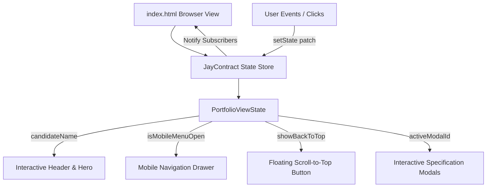

# Modern Technical Business Analyst Portfolio

[](tests/)
[](design-log/)
[](https://tailwindcss.com/)
[](LICENSE)

> **Portfolio of Nguyen Huu Hoang Pho**  
> *Junior Business Analyst | Technical Systems Integrator | Process Optimizer*  
> 📍 **Location**: Danang / Huong Phung, Quang Tri, Vietnam  
> 📧 **Direct Contact**: [hoangpho.2212@gmail.com](https://mail.google.com/mail/?view=cm&fs=1&to=hoangpho.2212@gmail.com)

---

## 🌟 Executive Overview

This repository houses the personal portfolio website of **Nguyen Huu Hoang Pho**, an analytical and technically-driven Junior Business Analyst with a solid engineering foundation in full-stack software development, desktop architecture, and automated data workflows.

Unlike traditional non-technical analysts, this profile bridges the gap between high-level business stakeholder requirements and low-level code implementation, turning ambiguous requirements into structured SRS documents, UML models, database schemas, and API gateway routing rules.

---

## 🧭 Live Preview & Quickstart

The portfolio is built as a zero-dependency, self-contained single-page application using modern HTML5, Tailwind CSS, and vanilla JavaScript.

### Option 1: Direct File Open
Simply open `index.html` in any modern web browser:
- On Windows: Double-click `index.html` or run:
  ```powershell
  Start-Process index.html
  ```

### Option 2: Local HTTP Server
```bash
# Using Python
python -m http.server 8080

# Or using Node npx serve
npx serve .
```
Navigate to `http://localhost:8080` in your browser.

---

## 💼 Core Competencies Matrix

The portfolio is structured around four technical and analytical quadrants:

| Domain Quadrant | Core Skills & Methodologies | Tools & Technologies |
| :--- | :--- | :--- |
| **Business Analysis & Agile** | Requirements Gathering (SRS), Use Case & Class Modeling, Workflow Design, Jira Sprint Planning, Agile/Scrum. | Jira, Confluence, UML, BPMN 2.0 |
| **Data & System Integration** | Database Design (Relational & Document), ETL Workflows, Automated Approval Pipelines, API Gateway Routing. | MongoDB, MySQL, Power Automate, Ocelot Gateway |
| **Technical Stack** | Desktop Client Development, Component-Based Frontend, Backend REST APIs, Relational Mapping. | C# / .NET Windows Forms, Java, JavaScript, Vue.js, PHP, RESTful APIs |
| **Testing & QA** | Input Validation Matrices, Edge Case Diagnostics, Acceptance Testing, Unit Test Automation. | xUnit, Manual QA, RegEx Data Constraints |

---

## 🏆 Leadership & Executive Soft Skills

- **Role**: Chairman of the Greenwich Football Club (Gre FC)
- **Impact & Governance**:
  - Directed end-to-end logistics, scheduling, and operations for an 8-team competitive championship.
  - Negotiated custom tournament regulations and structural bylaws directly with the institutional leadership board.
  - Aligned diverse volunteer cohorts and established cross-functional operational protocols under strict timelines.

---

## 🚀 Key Project Cases

### 1. Web-Based CMS Strategy & Prototype
- **Client / Partner**: Save the Children Vietnam
- **Tech Stack**: SharePoint, Power Automate, Microsoft Forms
- **BA Deliverables**:
  - Conducted field user research for bilingual educators and CSR directors.
  - Authored platform evaluation matrices prioritizing low-bandwidth resiliency and Role-Based Access Control (RBAC).
  - Designed automated human-in-the-loop multi-tier approval workflows.

### 2. Desktop Information System for Education Centre
- **Tech Stack**: C# .NET, MySQL, Object-Oriented Design
- **BA Deliverables**:
  - Authored a complete Software Requirements Specification (SRS) detailing functional requirements and ISO/IEC 25010 quality attributes.
  - Designed UML class diagrams, state transitions, and use case flows.
  - Formulated and verified a rigorous input validation matrix enforcing relational database integrity.

### 3. Microservices URL Shortener Platform
- **Tech Stack**: .NET Core, Vue.js, MongoDB, RabbitMQ
- **BA Deliverables**:
  - Managed 2-week Jira sprint cycles, user story acceptance criteria, and backlog grooming to decouple monolithic logic.
  - Configured Ocelot API Gateway routing rules.
  - Formulated asynchronous event-driven messaging contracts with RabbitMQ.

---

## 🏗️ Technical Architecture & JayContract Pattern

The portfolio front-end implements the **JayContract** pattern, providing an observable, immutable reactive state store without requiring heavyweight frameworks like React or Angular:



### State Contract Definition:
```typescript
interface PortfolioViewState {
  readonly candidateName: string;
  readonly isMobileMenuOpen: boolean;
  readonly scrollY: number;
  readonly showBackToTop: boolean;
  readonly activeModalId: string | null;
}
```

---

## 🧪 Testing & Verification

The project follows a strict **Test-Driven Development (TDD)** methodology with automated suites written using Node.js built-in test runner (`node:test`) and JSDOM:

### Running Tests:
```bash
# Run all test suites
npm test

# Run specific suites
node --test tests/portfolio.test.mjs
node --test tests/docs.test.mjs
```

### Verified Test Suites:
- `tests/portfolio.test.mjs`:
  - ✅ Section 1: Hero Section Content & CTAs
  - ✅ Section 2: Core Competencies Grid
  - ✅ Section 3: Leadership & Soft Skills Highlight Section
  - ✅ Section 4: Key Projects Interactive Cards
  - ✅ Section 5: Footer & Contact Section with Social Links and Scroll-to-Top
  - ✅ UX & Accessibility Attributes
- `tests/docs.test.mjs`:
  - ✅ `.gitignore` exclusion rules validation
  - ✅ `README.md` executive documentation compliance

---

## 📑 Design Logs Index

All architectural choices and specifications are documented in the `./design-log/` directory following the Jay Framework project rules:
- [#0001: Modern Responsive Portfolio Website Architecture](design-log/0001-portfolio-website.md)
- [#0002: Gmail Web Composer Integration for Recipient hoangpho.2212@gmail.com](design-log/0002-gmail-integration.md)
- [#0003: Repository Hygiene (.gitignore) and Technical Documentation (README.md)](design-log/0003-project-documentation-and-git-governance.md)

---

## 📬 Contact & Professional Links

- **Email**: [hoangpho.2212@gmail.com](https://mail.google.com/mail/?view=cm&fs=1&to=hoangpho.2212@gmail.com) *(Opens directly in Gmail web composer with prefilled recipient)*
- **LinkedIn**: [Nguyen Huu Hoang Pho on LinkedIn](https://www.linkedin.com/in/nguyen-huu-hoang-pho-fgw-dn-b5708b32b/)
- **GitHub**: [github.com/HoangPho2212](https://github.com/HoangPho2212)

---
*Created with focus on analytical clarity, accessible design, and software engineering rigor.*
