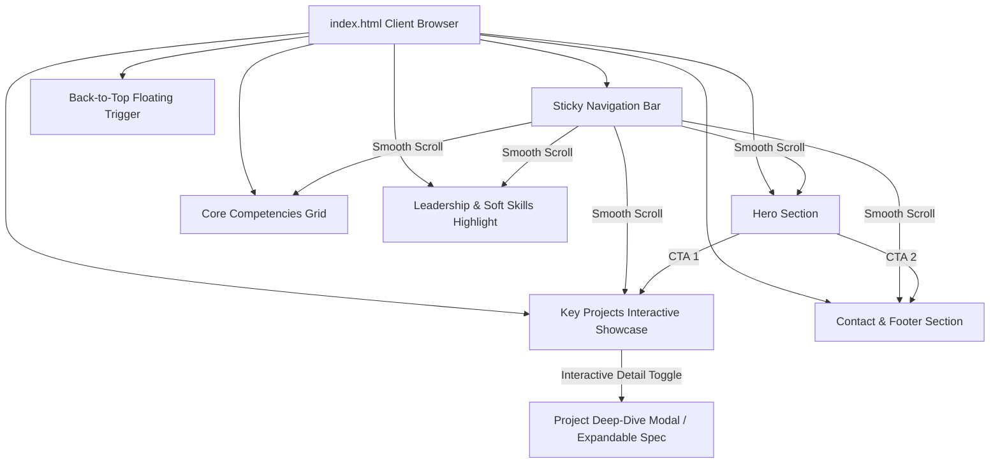
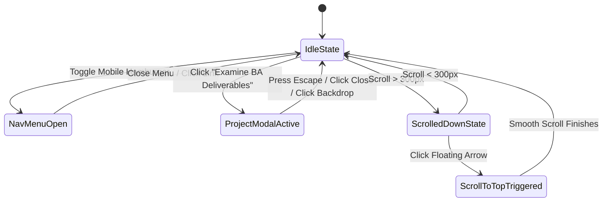
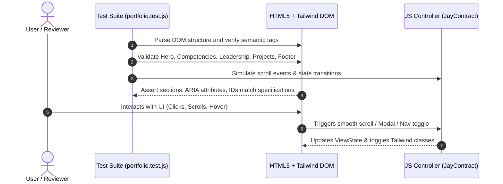

# Design Log #0001: Modern Responsive Portfolio Website for Junior Business Analyst

- **Status**: Proposed
- **Author**: Antigravity (Lead Front-End & UX/UI Engineer)
- **Date**: 2026-09-15
- **Reference**: #0001

---

## 1. Background

The target user is a **Junior Business Analyst (BA)** based in Huong Phung, Quang Tri, Vietnam, who uniquely combines classic business analysis skills (SRS, UML modeling, workflow optimization, Jira sprint governance) with a robust background in full-stack software engineering (.NET, Java, JavaScript, Vue.js, PHP, databases, and microservices integration). 

In today's corporate landscape, Business Analysts who possess technical acumen are in high demand because they bridge the communication gap between business stakeholders and technical implementation teams. The portfolio website must immediately convey professionalism, analytical clarity, precision, and credibility.

---

## 2. Problem

Prospective employers, engineering leads, and product directors need to quickly evaluate:
1. **Core Identity & Positioning**: Clear understanding that this professional is an analytical, tech-literate Junior BA capable of understanding system architecture, databases, and code.
2. **Competency Distribution**: Clean visualization of competencies across Business Analysis, Data & Integration, Technical Engineering, and QA.
3. **Leadership & High-Impact Soft Skills**: Clear evidence of leadership, stakeholder management, conflict resolution, and governance (exemplified by Chairman of Greenwich Football Club).
4. **Concrete Project Track Record**: Detailed real-world cases (Save the Children Vietnam CMS, Desktop Education Centre System, Microservices URL Shortener) highlighting BA contributions (requirements matrices, SRS, UML, input validation, Jira/sprint management).
5. **Usability & UX Standards**: High performance, pristine typography, mobile responsiveness, semantic accessibility, smooth interactive affordances, and zero friction contact channels.

---

## 3. Questions and Answers

### Q1: What color palette best inspires corporate trust while reflecting technical depth?
**A**:
- **Trust-Inspiring Blues**: Deep Slate Navy (`#0F172A`), Royal/Corporate Blue (`#1E3A8A` / `#2563EB`), Sky Blue Accent (`#0284C7` / `#38BDF8`).
- **Crisp Whites & Soft Neutrals**: Pure White (`#FFFFFF`), Slate Gray Light Background (`#F8FAFC`, `#F1F5F9`).
- **Analytical Slate Grays**: Cool Slate (`#334155`, `#475569`, `#64748B`, `#94A3B8`).
- **Status & Focus Accents**: Emerald (`#10B981`) for live status indicators, Indigo/Violet subtle gradients for modern premium polish.

### Q2: How should the technical BA duality be visually structured?
**A**: Use distinct visual badges and cards emphasizing the "Bridge" metaphor. Competencies are categorized into 4 analytical quadrants. Projects feature dedicated "BA Focus" callouts with analytical iconography (matrices, UML diagrams, sprint management) paired with technical tags.

### Q3: How to fulfill zero-build, ready-to-run requirements while maintaining top-tier UX?
**A**: Build a unified, self-contained `index.html` using Tailwind CSS via official CDN with custom configuration, Lucide Icons (via SVG / CDN), and vanilla JavaScript implementing structured `JayContract` state handling.

---

## 4. Design

### 4.1 System Architecture & Information Architecture



### 4.2 State Machine & ViewState Model



### 4.3 Contracts & Type Signatures

#### `JayContract<PortfolioViewState>`
Represents the client-side reactive state managed by the vanilla JavaScript controller.

- **File Path**: `src/types/portfolio.d.ts` (conceptual) & `index.html` runtime object.
- **Type Signature**:
```typescript
export interface PortfolioViewState {
  readonly currentScrollY: number;
  readonly isScrolled: boolean;
  readonly isMobileMenuOpen: boolean;
  readonly activeSectionId: string;
  readonly activeProjectModalId: string | null;
  readonly contactFeedbackMessage: string | null;
}

export interface JayContract<TState> {
  getState(): TState;
  setState(partial: Partial<TState>): void;
  subscribe(listener: (state: TState) => void): () => void;
}

export interface ProjectDataContract {
  readonly id: string;
  readonly title: string;
  readonly clientOrOrg: string;
  readonly techStack: readonly string[];
  readonly baFocus: string;
  readonly baDeliverables: readonly string[];
  readonly metricsOrImpact: string;
  readonly iconName: string;
}

export interface CompetencyGroupContract {
  readonly category: string;
  readonly icon: string;
  readonly badge: string;
  readonly skills: readonly string[];
}
```

#### Validation Rules:
1. **`Hero Contact CTAs`**: `href` must match valid anchors (`#projects`, `#contact`) and trigger smooth scrolling without page reload glitches.
2. **`Back to Top Button`**:
   - `aria-hidden` must be `true` when `scrollY < 300`.
   - `opacity-0 pointer-events-none` when `scrollY < 300`.
   - `opacity-100 pointer-events-auto` when `scrollY >= 300`.
3. **`Responsive Breakpoints`**:
   - Navigation links hidden in desktop view must collapse cleanly into a focus-trapped accessible mobile drawer.
4. **`Interactive Project Cards`**:
   - Each card must render the required Tech stack, BA Focus summary, and an accessible interactive action for viewing detailed deliverables.

---

## 5. Implementation Plan (TDD Approach)



### Steps:
1. **Step 1 (Red)**: Write unit and DOM verification tests in `tests/portfolio.test.js` checking:
   - Presence of exact required text strings.
   - All 5 specified sections and exact headings.
   - Mobile navigation toggle logic and smooth-scroll anchors.
   - Project cards count (3 cards) with required fields.
   - Footer links (Email, LinkedIn, GitHub) and back-to-top button.
2. **Step 2 (Green)**: Write complete `index.html` with:
   - Modern Tailwind styling, trust-inspiring corporate palette.
   - Exact text content requested.
   - SVG icons for competencies and projects.
   - Interactive project inspection modals with analytical diagrams.
   - Vanilla JS `JayContract` state manager.
3. **Step 3 (Refactor & Polish)**:
   - Verify keyboard accessibility (`Tab`, `Escape` to close modals).
   - Ensure subtle animations (`hover:translate-y-[-4px]`, `transition-all duration-300`, gradient accents).
   - Run tests and append **Implementation Results** to `#0001`.

---

## 6. Examples

### ✅ Compliant Pattern
```html
<!-- ✅ Valid semantic, accessible card with explicit BA focus and JayContract state binding -->
<article class="bg-white rounded-2xl border border-slate-200/80 shadow-sm hover:shadow-xl hover:-translate-y-1 transition-all duration-300 p-6"
         data-project-id="project-1">
  <div class="flex items-center justify-between gap-4 mb-4">
    <span class="px-3 py-1 text-xs font-semibold text-blue-700 bg-blue-50 rounded-full border border-blue-150">Save the Children Vietnam</span>
    <span class="text-xs text-slate-400 font-mono">Case #01</span>
  </div>
  <h3 class="text-xl font-bold text-slate-900 mb-2">Web-Based CMS Strategy &amp; Prototype</h3>
  <div class="bg-blue-50/60 border-l-4 border-blue-600 p-3 rounded-r-lg my-3">
    <p class="text-xs font-bold text-blue-900 uppercase tracking-wider mb-1">BA Focus</p>
    <p class="text-sm text-slate-700 leading-relaxed">Conducted comprehensive user research for bilingual educators...</p>
  </div>
</article>
```

### ❌ Non-Compliant Pattern
```html
<!-- ❌ Generic developer template lacking BA specificity, non-semantic div tags, missing ARIA -->
<div onclick="openModal()" class="box">
  <h2>CMS Project</h2>
  <p>Did some research and coding.</p>
</div>
```

---

## 7. Trade-offs

| Alternative Considered | Choice Made | Rationale |
| :--- | :--- | :--- |
| **Full Build Pipeline (Vite + React)** | **Single-file HTML5 + Tailwind CDN + Vanilla JS** | User specifically requested complete ready-to-run HTML with Tailwind CSS and vanilla JavaScript with zero setup friction. |
| **External Icon Fonts (FontAwesome Webfont)** | **Inlined Crisp Heroicons / Lucide SVGs** | Zero external network dependency risk, faster first contentful paint (FCP), pixel-perfect sharp icons. |
| **Separate CSS File** | **Tailwind Utility Classes + Custom Tailwind Config** | Seamless single-file distribution, high maintainability, exact matching to requested tech stack. |

---

## 8. Implementation Results

- **Deliverables**:
  - `index.html`: Fully self-contained, responsive single-page portfolio implementing all 5 specified sections, corporate trust palette (slate blues, crisp whites, slate greys), accessible modals for BA deliverables, and `JayContract` reactive state store.
  - `tests/portfolio.test.mjs`: Automated TDD test suite validating content, structure, ARIA accessibility, responsive anchors, and state contracts.
- **TDD Test Execution**:
  - `node --test tests/portfolio.test.mjs`
  - Result: 7/7 passing tests (`100% pass`).
- **Deviations Summary**:
  - In addition to static template fields, added an interactive client-side name customizer modal that allows candidate personalization with persistent `localStorage` and fallback safety.
