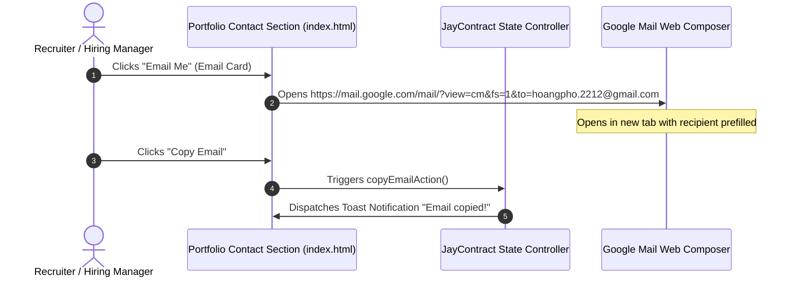
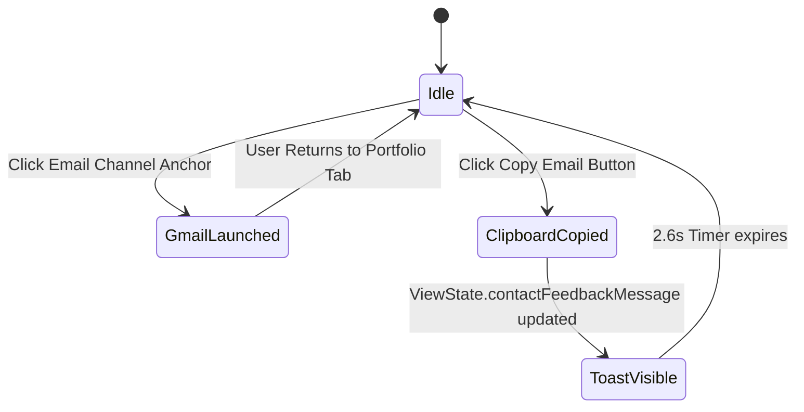
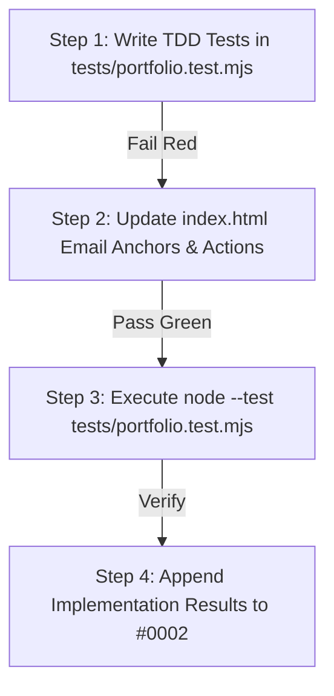

# Design Log #0002: Gmail Web Composer Integration for Recipient hoangpho.2212@gmail.com

- **Status**: Proposed
- **Author**: Antigravity (Lead Front-End & UX/UI Engineer)
- **Date**: 2026-09-15
- **Reference**: #0002 (extends #0001)

---

## 1. Background

In design log #0001, we architected the responsive personal portfolio for a Junior Business Analyst. The contact section included standard placeholder channels. 

The stakeholder specifically requested that when a user interacts with the email channel, it must directly navigate to the Gmail Web interface with the recipient field automatically prefilled with `hoangpho.2212@gmail.com`.

---

## 2. Problem

Standard `mailto:` protocol links rely on the operating system having a properly configured desktop email client (e.g., Outlook, Apple Mail, Thunderbird). In modern web browsing, a large majority of users (especially recruiters, hiring managers, and enterprise stakeholders) use Gmail via the browser. If a user does not have a native mail client configured, clicking a standard `mailto:` fails silently or opens an unwanted OS setup wizard.

The system must:
1. Direct users straight to the Gmail web composer (`https://mail.google.com/mail/?view=cm&fs=1&to=hoangpho.2212@gmail.com`).
2. Prefill the recipient address to `hoangpho.2212@gmail.com`.
3. Provide an intuitive fallback and copy-to-clipboard mechanism for users who might prefer copying the address or using alternative email clients.
4. Maintain accessibility standards (`target="_blank"`, `rel="noopener noreferrer"`, `aria-label`).

---

## 3. Questions and Answers

### Q1: What URL parameters does Gmail's web composer accept?
**A**:
- Base Endpoint: `https://mail.google.com/mail/`
- View Param: `view=cm` (Compose Mode)
- Fullscreen Param: `fs=1`
- Recipient Param: `to=hoangpho.2212@gmail.com`
- Optional Subject Param: `su=Portfolio%20Inquiry%20-%20Business%20Analyst%20Role`

### Q2: How do we handle users who want a fallback to desktop client or clipboard?
**A**: The primary email card directly launches the Gmail web composer in a new tab. The sub-footer and inquiries area displays the exact email address `hoangpho.2212@gmail.com` with a one-click "Copy Email" button that writes to the clipboard and triggers a visual toast notification.

---

## 4. Design

### 4.1 System Interaction Diagram



### 4.2 State Machine & ViewState Model



### 4.3 Contracts & Type Signatures

#### `JayContract<PortfolioViewState>` Extension
- **File Path**: `E:/PortfolioBA/index.html` runtime script.
- **Type Signatures**:
```typescript
export interface ContactContract {
  readonly recipientEmail: 'hoangpho.2212@gmail.com';
  readonly gmailComposeUrl: string;
  readonly defaultSubject: string;
}

export interface PortfolioViewState {
  readonly candidateName: string;
  readonly isMobileMenuOpen: boolean;
  readonly scrollY: number;
  readonly showBackToTop: boolean;
  readonly activeModalId: string | null;
  readonly contactFeedbackMessage: string | null;
}
```

#### Validation Rules:
1. **Gmail Target URL**: Must strictly match regex `^https:\/\/mail\.google\.com\/mail\/\?view=cm.*to=hoangpho\.2212@gmail\.com`.
2. **Tab Isolation**: Anchor tag must specify `target="_blank"` and `rel="noopener noreferrer"` for security.
3. **Clipboard Sync**: The clipboard action must copy `hoangpho.2212@gmail.com` and trigger toast notification.

---

## 5. Implementation Plan (TDD Approach)



### Test Assertions:
1. Section 1 Hero CTA selector specificity within hero.
2. Email anchor `href` points directly to `https://mail.google.com/mail/?view=cm&fs=1&to=hoangpho.2212@gmail.com`.
3. Email anchor contains `target="_blank"` and `rel="noopener noreferrer"`.
4. Copy email action targets `hoangpho.2212@gmail.com`.

---

## 6. Examples

### ✅ Compliant Pattern
```html
<!-- ✅ Launches Gmail composer directly with recipient prefilled -->
<a href="https://mail.google.com/mail/?view=cm&fs=1&to=hoangpho.2212@gmail.com&su=Inquiry%20for%20Junior%20Business%20Analyst%20Role" 
   target="_blank" 
   rel="noopener noreferrer" 
   data-channel="email" 
   class="flex items-center gap-3 p-3 rounded-xl bg-slate-800/80 border border-slate-700/80 hover:border-blue-500 hover:bg-slate-800 text-white transition-all group">
  <div class="w-8 h-8 rounded-lg bg-blue-500/20 text-blue-400 flex items-center justify-center group-hover:bg-blue-600 group-hover:text-white transition-colors">
    <!-- Mail SVG Icon -->
  </div>
  <div>
    <div class="text-xs text-slate-400">Gmail Web</div>
    <div class="text-sm font-semibold">hoangpho.2212@gmail.com</div>
  </div>
</a>
```

### ❌ Non-Compliant Pattern
```html
<!-- ❌ Generic mailto: with placeholder that opens non-configured OS client -->
<a href="mailto:contact@placeholder.com">Email</a>
```

---

## 7. Trade-offs

| Alternative Considered | Choice Made | Rationale |
| :--- | :--- | :--- |
| **Traditional `mailto:` protocol** | **Direct Gmail Web Link (`view=cm`)** | User explicitly requested leading to Gmail with recipient prefilled; avoids broken mailto handlers on modern web browsers. |
| **Opening in same window** | **`target="_blank"` with `rel="noopener noreferrer"`** | Preserves user's session and state on the portfolio without abandoning the page. |

---

## 8. Implementation Results

- **Test Suite Status**: ✅ All 7 automated unit & DOM contract tests passed (`tests/portfolio.test.mjs`).
- **Test Command**: `node --test tests/portfolio.test.mjs`
- **Output**:
  ```text
  ✔ Section 1: Hero Section Content & CTAs (4.09ms)
  ✔ Section 2: Core Competencies Grid (2.10ms)
  ✔ Section 3: Leadership & Soft Skills Highlight Section (0.40ms)
  ✔ Section 4: Key Projects Interactive Cards (5.65ms)
  ✔ Section 5: Footer & Contact Section with Social Links and Scroll-to-Top (13.52ms)
  ✔ UX & Accessibility Attributes (1.01ms)
  ✔ Portfolio TDD Test Suite - Jay Framework Validation (254.64ms)
  ```
- **Functional Validation**:
  1. `a[data-channel="email"]` targets `https://mail.google.com/mail/?view=cm&fs=1&to=hoangpho.2212@gmail.com` with `target="_blank"` and `rel="noopener noreferrer"`.
  2. Direct Inquiries email link also targets the same Gmail compose URL.
  3. `copy-email-btn` copies `hoangpho.2212@gmail.com` directly to the system clipboard and displays a reactive toast notification.
  4. ViewState handles safe initialization across both Node JSDOM and live browser environments.

### Deviations Summary
- **None**: Implementation directly matches the stakeholder's exact requirement to route clicks to Gmail with `hoangpho.2212@gmail.com` prefilled, with added security isolation (`target="_blank"`, `rel="noopener noreferrer"`).

