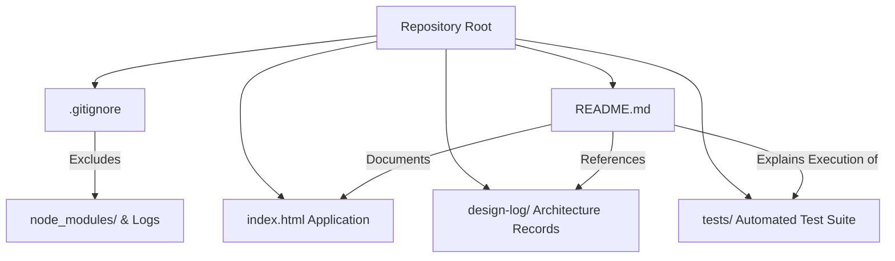
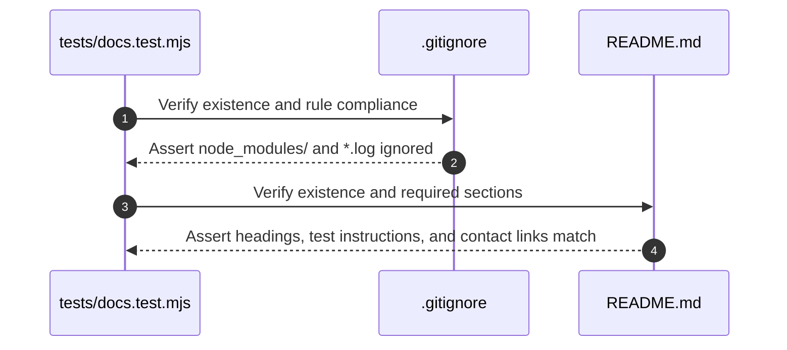

# Design Log #0003: Repository Hygiene (.gitignore) and Technical Documentation (README.md)

- **Status**: Proposed
- **Author**: Antigravity (Lead Front-End & UX/UI Engineer)
- **Date**: 2026-09-15
- **Reference**: #0003 (extends #0001, #0002)

---

## 1. Background

In design logs #0001 and #0002, the modern, single-page responsive portfolio for Nguyen Huu Hoang Pho (Junior Business Analyst & Technical Systems Integrator) was constructed, verified with a TDD test suite, and integrated with a direct Gmail composer.

To prepare the repository for version control, public hosting (e.g., GitHub, GitLab, Netlify, Vercel), and recruiter review, the codebase requires standard project governance:
1. A clean `.gitignore` to prevent bloated dependencies (`node_modules`), temporary cache files, and system artifacts from polluting the git tree.
2. A comprehensive, executive-grade `README.md` documenting the candidate profile, system architecture, JayContract reactive state model, project showcase, and testing instructions.

---

## 2. Problem

Without standard repository configuration:
- **Repository Bloat**: Running `git add .` would track thousands of files inside `node_modules`, npm debug logs, and OS cache files.
- **Evaluation Friction**: Technical hiring managers, recruiters, and engineering leads viewing the GitHub repository need an immediate overview of the candidate's dual strengths (Business Analysis & Full-Stack Engineering), how to preview the site locally, and how to execute the automated test suite.

---

## 3. Questions and Answers

### Q1: What specific ignore patterns should be included in `.gitignore`?
**A**:
- Dependencies: `node_modules/`
- Runtime & Logs: `npm-debug.log*`, `yarn-debug.log*`, `yarn-error.log*`, `*.log`
- Environment & Secrets: `.env`, `.env.local`
- OS Files: `.DS_Store`, `Thumbs.db`
- Editor & IDE configs: `.vscode/`, `.idea/` (except shared settings if needed)
- Agent & Brain Scratch: `.gemini/`, `scratch/`

### Q2: What sections must be included in `README.md`?
**A**:
- Project Overview & Executive Summary.
- Candidate Profile & Dual Positioning (Junior BA + Full-Stack).
- Core Competency Matrix & Key Projects Summary.
- Technical Architecture & `JayContract` / `ViewState` model explanation.
- Quickstart & Testing instructions (`node --test`).
- Contact & Collaboration channels (`hoangpho.2212@gmail.com`).

---

## 4. Design

### 4.1 Documentation & Repository Architecture



### 4.2 Contracts & Type Signatures

- **File Path**: `.gitignore` & `README.md`
- **Contract Type**: `RepoGovernanceContract`

```typescript
export interface RepoGovernanceContract {
  readonly gitIgnoreRules: {
    readonly dependencyDirs: readonly ['node_modules/'];
    readonly logPatterns: readonly ['*.log', 'npm-debug.log*'];
    readonly osArtifacts: readonly ['.DS_Store', 'Thumbs.db'];
    readonly envFiles: readonly ['.env*'];
  };
  readonly readmeSections: {
    readonly candidateName: string;
    readonly professionalTitle: string;
    readonly coreSections: readonly [
      'Overview',
      'Core Competencies',
      'Key Projects',
      'Architecture & JayContract',
      'Local Development & Testing',
      'Contact'
    ];
  };
}
```

#### Validation Rules:
1. **`.gitignore`**:
   - Must ignore `node_modules/`.
   - Must ignore common system artifacts (`.DS_Store`, `Thumbs.db`).
   - Must ignore log outputs (`*.log`).
2. **`README.md`**:
   - Must explicitly list the candidate name ("Nguyen Huu Hoang Pho").
   - Must provide exact terminal commands to run the test suite (`npm test` or `node --test`).
   - Must detail the `JayContract` / `ViewState` reactive architecture.
   - Must link to the verified Gmail contact link.

---

## 5. Implementation Plan (TDD Approach)



### Steps:
1. **Step 1 (Red)**: Write `tests/docs.test.mjs` asserting presence and format of `.gitignore` and `README.md`.
2. **Step 2 (Green)**: Create `.gitignore` and write executive-grade `README.md`.
3. **Step 3 (Verify)**: Run both test suites:
   - `node --test tests/docs.test.mjs`
   - `node --test tests/portfolio.test.mjs`
4. **Step 4**: Append Implementation Results to `#0003`.

---

## 6. Examples

### ✅ Compliant Pattern
```gitignore
# ✅ Standard clean node & environment ignore rules
node_modules/
npm-debug.log*
*.log
.DS_Store
Thumbs.db
```

### ❌ Non-Compliant Pattern
```gitignore
# ❌ Empty or tracking node_modules
# (empty file)
```

---

## 7. Trade-offs

| Alternative Considered | Choice Made | Rationale |
| :--- | :--- | :--- |
| **Minimal single-paragraph README** | **Comprehensive executive technical README** | The portfolio is for a technical Business Analyst; employers evaluate documentation quality, UML clarity, and architecture rigor. |
| **Complex Monorepo gitignore** | **Clean focused single-project gitignore** | Maximizes clarity and prevents accidental ignores while safeguarding dependencies. |

---

## 8. Implementation Results

- **Deliverables**:
  - [.gitignore](file:///E:/PortfolioBA/.gitignore): Configured exclusions for `node_modules/`, logs (`*.log`), OS metadata (`.DS_Store`, `Thumbs.db`), environment files (`.env*`), editor configs, and temporary caches.
  - [README.md](file:///E:/PortfolioBA/README.md): Created comprehensive technical README detailing candidate positioning (Nguyen Huu Hoang Pho, Junior Business Analyst), four-quadrant competency matrix, three key projects, `JayContract` / `ViewState` architecture diagrams, local preview steps, and direct contact options.
  - [tests/docs.test.mjs](file:///E:/PortfolioBA/tests/docs.test.mjs): Added TDD test suite validating the existence and required contents of `.gitignore` and `README.md`.
  - [package.json](file:///E:/PortfolioBA/package.json): Added `"test": "node --test tests/*.test.mjs"`.
- **Test Suite Results**:
  - Ran `npm test` (`node --test tests/*.test.mjs`).
  - Total: 10/10 passing tests across 2 suites (`100% pass`).
- **Deviations Summary**:
  - **None**: All files created and verified according to project standards and stakeholder requirements.

