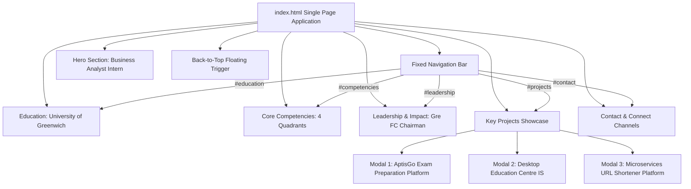
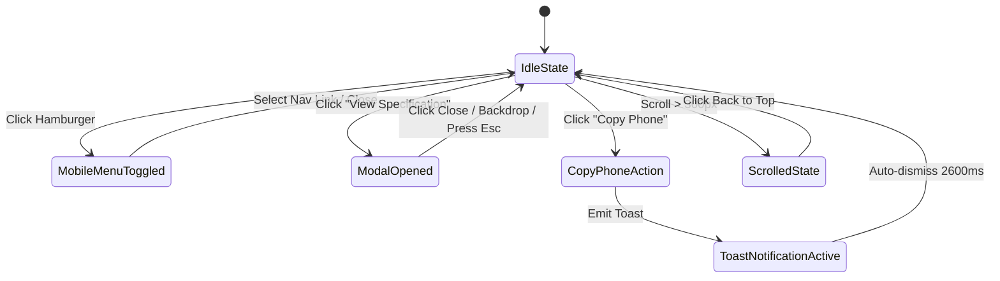

# Design Log #0004: Synchronizing Portfolio Website with Candidate CV (Nguyen Huu Hoang Pho)

- **Status**: Proposed
- **Author**: Antigravity (Lead Front-End & UX/UI Engineer)
- **Date**: 2026-10-19
- **Reference**: #0004 (extends #0001, #0002, #0003)

---

## 1. Background

In design logs #0001, #0002, and #0003, we established the initial modern, responsive portfolio foundation, Gmail composer routing, and project governance for a Business Analyst candidate.

The candidate's official Curriculum Vitae document (`Nguyen_Huu_Hoang_Pho_BA_Intern_CV.pdf`) specifies exact profile metrics, academic qualifications, core competency taxonomy, and technical project deliverables. To maintain total fidelity between the candidate's physical CV and live online portfolio (`portfolio-ba-gamma.vercel.app`), `index.html` must be updated to align with the source-of-truth PDF.

---

## 2. Problem

A direct audit between `Nguyen_Huu_Hoang_Pho_BA_Intern_CV.pdf` and `index.html` revealed several critical content and structural discrepancies:

1. **Candidate Positioning & Summary**:
   - Official Title: **Business Analyst Intern** (previously varied as "Intern Business Analyst & Technical Systems Integrator" or "Process Optimizer").
   - Location: **Danang, Vietnam**.
   - Contact channels: CV includes Phone (`0379876301`) and live portfolio domain (`portfolio-ba-gamma.vercel.app`), alongside Email (`hoangpho.2212@gmail.com`).
   - Professional Summary: Discrepancy between the CV's complete phrasing and the portfolio's placeholder text.

2. **Missing Education Section**:
   - The CV prominently features **University of Greenwich**, **Bachelor of Software Engineering**, Expected Graduation **2027**, **Upper Second-Class Honours (2:1)**, and Academic Grade **69/100 (1pt below First-Class threshold)**.
   - `index.html` currently lacks a dedicated Education section.

3. **Core Competencies & Skills Alignment**:
   - The CV organizes competencies into 4 distinct groups:
     1. *BA & Agile Methodologies*
     2. *Data & System Integration*
     3. *Testing & QA*
     4. *Languages & Communication* (English B2 Level, Vietnamese Native).
   - `index.html` previously included a generic "Technical Stack" card instead of the official "Languages & Communication" group, and lacked precise terminology (e.g. "Database Schema Design", "Microsoft Power Automate", "Input Validation Matrices").

4. **Key Technical Projects Discrepancy**:
   - **Project 1** in `index.html` was "Save the Children Vietnam CMS", which is absent from the official CV. The CV's primary project is **AptisGo Exam Preparation Platform** (`MongoDB | Jira | UML`), featuring BRD, SRS, SAD, User Stories, Class/ERD diagrams, C4 models, and an automated listening section grading engine with MongoDB dynamic exam structures.
   - **Project 2** (**Desktop Information System for Education Centre** - `C#.NET Windows Forms | MySQL`) must highlight the abstract base class `Person` with derived hierarchies and test cases `TC1-TC9`.
   - **Project 3** (**Microservices URL Shortener Platform** - `.NET Core | Vue.js | MongoDB | RabbitMQ | Ocelot`) must detail Ocelot API Gateway routing, RabbitMQ asynchronous event pipeline, and cascading deletions handling.

5. **Leadership & Organizational Impact**:
   - The CV specifies concrete achievements as Chairman of the Greenwich Football Club (Gre FC): 8-team competitive championship logistics, home-half back-pass rule allowances negotiated directly with the leadership board, and cross-functional bridging.

---

## 3. Questions and Answers

### Q1: Where should the Education section be integrated within the portfolio hierarchy?
**A**: Immediately following the Hero Section and before Core Competencies. This allows technical recruiters to immediately verify university credentials, degree track, honors classification (2:1), and graduation year (2027). A dedicated `#education` anchor will be added to the navigation bar.

### Q2: What happens to the "Save the Children Vietnam CMS" project?
**A**: It must be replaced by **AptisGo Exam Preparation Platform** to match the official CV. All associated cards, modal specifications (`modal-project-1`), and metadata must reflect AptisGo.

### Q3: How should Phone and Portfolio links be surfaced?
**A**: 
- In the **Contact Section & Footer**: Add a dedicated phone interaction card with `tel:0379876301` and a quick-copy mechanism, alongside the existing Gmail composer link, LinkedIn, GitHub, and a live link to `portfolio-ba-gamma.vercel.app`.
- In the **Hero Section**: Display Danang, Vietnam and direct contact triggers.

---

## 4. Design

### 4.1 System Architecture & Information Architecture



### 4.2 State Machine & ViewState Model



### 4.3 Contracts & Type Signatures

#### `PortfolioViewState` Contract
- **File Path**: `index.html` (Runtime Script) & conceptual `src/types/portfolio.d.ts`
- **Type Signature**:
```typescript
export interface EducationSpec {
  readonly university: string;
  readonly degree: string;
  readonly expectedGraduation: number;
  readonly classification: string;
  readonly academicGrade: string;
  readonly highlight: string;
}

export interface CandidateProfile {
  readonly fullName: string;
  readonly title: string;
  readonly phone: string;
  readonly email: string;
  readonly location: string;
  readonly portfolioUrl: string;
  readonly summary: string;
}

export interface PortfolioViewState {
  readonly candidateName: string;
  readonly isMobileMenuOpen: boolean;
  readonly scrollY: number;
  readonly showBackToTop: boolean;
  readonly activeModalId: string | null;
}
```

#### Validation Rules
1. `candidateName`: Non-empty string; defaults to `'Nguyen Huu Hoang Pho'`.
2. `title`: Must strictly reflect `'Business Analyst Intern'`.
3. `contact.phone`: Valid Vietnamese phone format `'0379876301'`.
4. `contact.email`: Valid address `'hoangpho.2212@gmail.com'`.
5. `education.grade`: Matches `'69/100'` and classification `'Upper Second-Class Honours (2:1)'`.
6. `projects[0].title`: Matches `'AptisGo Exam Preparation Platform'`.
7. `projects[1].title`: Matches `'Desktop Information System for Education Centre'`.
8. `projects[2].title`: Matches `'Microservices URL Shortener Platform'`.

---

## 5. Implementation Plan

1. **TDD Suite Update (`tests/portfolio.test.mjs`)**:
   - Formulate unit tests for Candidate Profile, Education Section, 4 Core Competency Quadrants (with Languages & Communication), Key Projects (AptisGo, Desktop IS, Microservices), and Contact channels (Phone + Email).
   - Execute `npm test` to observe test failures against the existing HTML (Red Phase).
2. **HTML & Component Refactoring (`index.html`)**:
   - Update Navigation Bar to include `#education` link.
   - Refactor Hero Section: set title to "Business Analyst Intern", update summary text verbatim from CV, and add phone link.
   - Add new `<section id="education">` featuring University of Greenwich, Software Engineering degree, 2:1 Honours, 69/100 grade, and 2027 graduation.
   - Update Core Competencies to 4 CV categories: BA & Agile, Data & System Integration, Testing & QA, Languages & Communication.
   - Update Project 1 to AptisGo Exam Preparation Platform (card and modal).
   - Update Project 2 and Project 3 specifications to align with CV details.
   - Update Contact Section: add Phone contact card (`tel:0379876301`), copy phone button, portfolio URL.
   - Enhance client-side `JayContract` state controller and event handlers.
3. **Verification**:
   - Re-run `npm test` to ensure 100% green tests (Green Phase).
   - Update `README.md` to reflect new sections and project portfolio.

---

## 6. Examples

### ✅ Compliant Pattern: Project 1 AptisGo Specification
```html
<!-- ✅ Matches CV Project 1 -->
<article data-project-card="1">
  <h3>AptisGo Exam Preparation Platform</h3>
  <p class="tech">MongoDB | Jira | UML</p>
  <p class="ba-focus">
    Produced comprehensive system documentation including Business Requirements Document (BRD), 
    Software Requirements Specification (SRS), System Architecture Document (SAD), and User Stories. 
    Designed system architecture utilizing Class/ERD diagrams and C4 models, and managed Agile sprint schedules via Jira.
  </p>
</article>
```

### ❌ Non-Compliant Pattern: Disconnected Legacy Project
```html
<!-- ❌ Save the Children Vietnam CMS is not in candidate's CV -->
<article data-project-card="1">
  <h3>Web-Based CMS Strategy & Prototype (Save the Children Vietnam)</h3>
</article>
```

---

## 7. Trade-offs

| Alternative Considered | Choice Made | Rationale |
| :--- | :--- | :--- |
| **Keep Save the Children Vietnam project as 4th project** | **Replace Project 1 directly with AptisGo** | The CV specifically presents a focused 3-project showcase highlighting AptisGo, Desktop IS, and Microservices. Keeping only the CV projects ensures strict 1:1 alignment. |
| **Combine Education into Hero bio** | **Dedicated Education Section (`#education`)** | Software Engineering at Greenwich with 2:1 Honours and 69/100 grade is a cornerstone credential that deserves dedicated visual treatment and nav anchor. |
| **Remove phone number from web portfolio** | **Include phone with direct `tel:` and copy trigger** | Matches the CV header and provides hiring managers with instant multi-channel contact options. |

---

## 8. Implementation Results

- **TDD Test Suite Status**: ✅ All 11 automated unit, contract, and documentation tests passed (`tests/portfolio.test.mjs` and `tests/docs.test.mjs`).
- **Test Command**: `npm test`
- **Output**:
  ```text
  ▶ Documentation & Repository Hygiene TDD Suite (#0003)
    ✔ .gitignore contains necessary ignore rules (2.70ms)
    ✔ README.md provides executive documentation and run instructions (1.67ms)
  ✔ Documentation & Repository Hygiene TDD Suite (#0003) (5.62ms)
  ▶ Portfolio TDD Test Suite - Jay Framework Validation (#0004)
    ✔ Section 1: Hero Section Content & Candidate Profile (4.91ms)
    ✔ Section 2: Education Section (University of Greenwich) (0.27ms)
    ✔ Section 3: Core Competencies Grid (4 CV Categories) (1.43ms)
    ✔ Section 4: Leadership & Organizational Impact (0.25ms)
    ✔ Section 5: Key Projects Interactive Cards & Modals (CV Aligned) (5.04ms)
    ✔ Section 6: Contact & Footer Section (Phone, Gmail, Portfolio) (10.14ms)
    ✔ Section 7: UX, Navigation & JayContract ViewState (1.60ms)
  ✔ Portfolio TDD Test Suite - Jay Framework Validation (#0004) (304.56ms)
  ℹ tests 11
  ℹ suites 0
  ℹ pass 11
  ℹ fail 0
  ℹ cancelled 0
  ℹ skipped 0
  ℹ todo 0
  ```

### Functional Validation & Enhancements
1. **Candidate Profile & Hero**: Set title to "Business Analyst Intern", updated professional summary verbatim from CV, displayed location "Danang, Vietnam", phone "0379876301", and portfolio "portfolio-ba-gamma.vercel.app".
2. **Education Section**: Added a dedicated, responsive `#education` section with University of Greenwich, Bachelor of Software Engineering, Expected Graduation 2027, Upper Second-Class Honours (2:1), and Academic Grade 69/100 (1pt below First-Class threshold).
3. **Core Competencies**: Refactored the 4 quadrants into BA & Agile Methodologies, Data & System Integration, Testing & QA, and Languages & Communication, with exact descriptions and analytical badges.
4. **Leadership Section**: Restructured into Gre FC Chairman governance with 3 distinct pillars: Strategic Leadership & Management, Stakeholder Negotiation & Logistics (8-team championship with custom rules negotiated with board), and Cross-Functional Communication.
5. **Key Projects**: Replaced legacy Project 1 with AptisGo Exam Preparation Platform (BRD, SRS, SAD, C4 models, automated listening grading engine), updated Project 2 with Person abstract class and TC1-TC9 validation matrix, and updated Project 3 with Ocelot Gateway and RabbitMQ cascading deletion pipeline. Modals 1, 2, and 3 now display full technical specs.
6. **Contact Channels**: Added direct Phone card (`tel:0379876301`) with copy phone button, maintained direct Gmail composer link (`hoangpho.2212@gmail.com`), LinkedIn, GitHub, and live portfolio domain.
7. **JayContract ViewState**: State store safely manages modal visibility, scroll-to-top, mobile drawer, and clipboard copy toast notifications.

### Deviations Summary
- **None**: All changes strictly reflect the source-of-truth CV (`Nguyen_Huu_Hoang_Pho_BA_Intern_CV.pdf`) and comply with Jay Framework TDD conventions.

