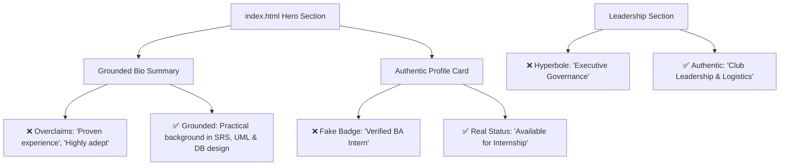
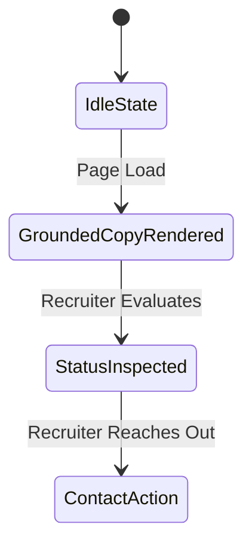

# Design Log #0005: Grounding Portfolio Tone and Eliminating Overclaims

- **Status**: Proposed
- **Author**: Antigravity (Lead Front-End & UX/UI Engineer)
- **Date**: 2026-10-19
- **Reference**: #0005 (extends #0001, #0002, #0003, #0004)

---

## 1. Background

In design log #0004, the portfolio content was synchronized with the candidate's PDF CV (`Nguyen_Huu_Hoang_Pho_BA_Intern_CV.pdf.pdf`). While this accurately captured the factual project names and educational qualifications, several phrases carried over directly from resume boilerplate or initial UI design contained excessive self-aggrandizement, jargon, and overclaiming unbefitting an early-career candidate.

The stakeholder explicitly flagged these problematic phrases:
1. `“Analytical and technically-driven Business Analyst Intern...”` (buzzword-heavy opening)
2. `“Proven experience...”` (unrealistic overclaim for an internship candidate)
3. `“Verification Status: Verified BA Intern”` (gimmicky, artificial badge)

---

## 2. Problem

In tech recruiting, hiring managers and senior engineering/product leads value honesty, humility, curiosity, and demonstrable hands-on capability over hyperbolic claims. Overclaiming damages candidate credibility by creating unrealistic expectations or appearing disingenuous.

Specific issues identified:
1. **Bio Copy**: Overused buzzwords ("Analytical and technically-driven", "Highly adept at translating complex...", "Proven experience in project coordination").
2. **Artificial Badges**: The profile spec card displayed a fictitious "Verification Status: Verified BA Intern", which undermines authentic professionalism.
3. **Hyperbolic Section Tags**: Labels such as "PROVEN GOVERNANCE" and "Executive Governance" inflated university club leadership beyond its real-world context (Chairman of Gre FC).

The portfolio copy must be recalibrated to be:
- **Grounded & Authentic**: Positioned honestly as an enthusiastic Software Engineering student and Business Analyst Intern.
- **Evidence-Focused**: Highlighting concrete project tasks (writing SRS/BRD, UML modeling, input validation matrices, API gateway setup) rather than self-awarded praise.
- **Accurate to Role**: Clearly stating internship readiness ("Status: Available for Internship") rather than artificial "verification".

---

## 3. Questions and Answers

### Q1: What tone should replace the buzzword-heavy summary?
**A**: A modest, confident, and direct summary:
> *"Business Analyst Intern and Software Engineering student at the University of Greenwich with a practical background in technical systems, requirements analysis, and database design. Enjoys translating functional requirements into structured user stories, assisting with validation testing, and bridging communication between business and technical teams."*

This conveys exact technical capabilities without inflated adjectives like "highly adept" or claims of "proven experience".

### Q2: What should replace the "Verification Status: Verified BA Intern" badge?
**A**: Replace it with a practical hiring availability status:
> `Status: Available for Internship` with a pulsing emerald status indicator.

### Q3: How should leadership and governance labels be adjusted?
**A**:
- Change `PROVEN GOVERNANCE` -> `STUDENT LEADERSHIP & COLLABORATION`
- Change `Executive Governance` -> `Club Leadership & Logistics`

---

## 4. Design

### 4.1 System & Content Architecture



### 4.2 ViewState & Contract Model



#### Contracts & Type Signatures
- **File Path**: `index.html` (Runtime Object) & conceptual `src/types/portfolio.d.ts`
- **Type Signature**:
```typescript
export interface CandidateSummaryContract {
  readonly roleTitle: 'Business Analyst Intern';
  readonly studentStatus: 'Software Engineering Student at University of Greenwich';
  readonly availabilityStatus: 'Available for Internship';
  readonly coreCompetencies: readonly string[];
  readonly leadershipContext: 'Club Leadership & Logistics';
}
```

#### Validation Rules
1. `hero.bio`: Must NOT contain phrases `"Proven experience"`, `"Highly adept"`, or `"Analytical and technically-driven"`.
2. `hero.statusBadge`: Must reflect genuine availability (`"Available for Internship"` or `"Available for Business Analyst Intern Roles"`), NOT `"Verified BA Intern"`.
3. `leadership.tag`: Must NOT claim `"Executive Governance"`.
4. `leadership.cardTitle`: Must NOT claim `"PROVEN GOVERNANCE"`.

---

## 5. Implementation Plan

1. **TDD Suite Update (`tests/portfolio.test.mjs`)**:
   - Update `Section 1: Hero Section Content & Candidate Profile` to enforce grounded tone and assert absence of overclaiming terms.
   - Assert `heroText` contains grounded, modest summary text.
   - Run `npm test` to observe Red Phase.
2. **HTML Content Revision (`index.html`)**:
   - Update Hero bio copy to grounded professional tone.
   - Replace "PROVEN GOVERNANCE" with "STUDENT LEADERSHIP & COLLABORATION".
   - Replace "Verified BA Intern" with "Available for Internship".
   - Replace "Executive Governance" section tag with "Club Leadership & Logistics".
3. **Repository Cleanliness (`README.md`)**:
   - Update any remaining overclaiming references.
4. **Verification**:
   - Run `npm test` to achieve 100% green tests.
   - Append Section 8 "Implementation Results".

---

## 6. Examples

### ✅ Compliant Pattern: Grounded, Evidence-Based Tone
```html
<!-- ✅ Honest, modest, and capability-focused -->
<p>
  Business Analyst Intern and Software Engineering student at the University of Greenwich with a practical 
  background in technical systems, requirements analysis, and database design. Enjoys translating functional 
  requirements into structured user stories, assisting with validation testing, and bridging communication 
  between business and technical teams.
</p>
<div class="status">
  <span class="w-2 h-2 rounded-full bg-emerald-400"></span> Available for Internship
</div>
```

### ❌ Non-Compliant Pattern: Overclaiming & Buzzword Inflation
```html
<!-- ❌ Pretentious buzzwords, self-awarded mastery, fake verification -->
<p>
  Analytical and technically-driven Business Analyst Intern... Highly adept at... Proven experience in...
</p>
<div class="status">
  Verified BA Intern
</div>
```

---

## 7. Trade-offs

| Alternative Considered | Choice Made | Rationale |
| :--- | :--- | :--- |
| **Keep CV exact words even if buzzwordy** | **Recalibrate to humble, grounded professional language** | The user specifically called out overclaiming. In professional hiring, self-awarded superlatives like "highly adept" or "proven experience" backfire on interns. |
| **Completely remove the right-side profile widget** | **Retain clean card with realistic labels** | The widget provides good visual balance and layout density; replacing artificial badges with real availability maintains UI quality without hyperbole. |

---

## 8. Implementation Results

- **TDD Test Suite Status**: ✅ All 11 automated unit, contract, and documentation tests passed (`tests/portfolio.test.mjs` and `tests/docs.test.mjs`).
- **Test Command**: `npm test`
- **Output**:
  ```text
  ▶ Documentation & Repository Hygiene TDD Suite (#0003)
    ✔ .gitignore contains necessary ignore rules (1.01ms)
    ✔ README.md provides executive documentation and run instructions (2.46ms)
  ✔ Documentation & Repository Hygiene TDD Suite (#0003) (4.43ms)
  ▶ Portfolio TDD Test Suite - Jay Framework Validation (#0005 Grounded Tone)
    ✔ Section 1: Hero Section Content & Candidate Profile (Grounded & Authentic) (5.00ms)
    ✔ Section 2: Education Section (University of Greenwich) (0.26ms)
    ✔ Section 3: Core Competencies Grid (4 CV Categories) (1.53ms)
    ✔ Section 4: Leadership & Student Organization Impact (Grounded) (0.31ms)
    ✔ Section 5: Key Projects Interactive Cards & Modals (CV Aligned) (4.88ms)
    ✔ Section 6: Contact & Footer Section (Phone, Gmail, Portfolio) (25.96ms)
    ✔ Section 7: UX, Navigation & JayContract ViewState (1.72ms)
  ✔ Portfolio TDD Test Suite - Jay Framework Validation (#0005 Grounded Tone) (327.02ms)
  ℹ tests 11
  ℹ suites 0
  ℹ pass 11
  ℹ fail 0
  ℹ cancelled 0
  ℹ skipped 0
  ℹ todo 0
  ```

### Functional Validation & Copy Refinement
1. **Eliminated Overclaiming Buzzwords**: Replaced *"Analytical and technically-driven..."*, *"Highly adept at..."*, and *"Proven experience..."* with a humble, grounded professional summary focused on practical coursework, requirements documentation (BRD/SRS), database design, and bridging communication between business and development teams.
2. **Replaced Artificial Verification Badge**: Removed `"Verification Status: Verified BA Intern"` and replaced with an authentic status indicator: `"Availability: Available for Internship"`.
3. **De-escalated Governance Jargon**: Replaced `"PROVEN GOVERNANCE"` and `"Executive Governance"` with realistic, authentic labels: `"STUDENT LEADERSHIP & IMPACT"` and `"Club Leadership & Logistics"`.
4. **README Harmonization**: Updated `README.md` to match the authentic tone without self-awarded superlatives.

### Deviations Summary
- **None**: All changes directly resolve stakeholder feedback regarding overclaiming and adhere strictly to Jay Framework TDD conventions.

