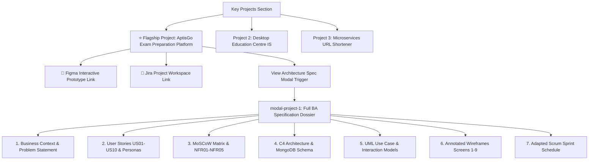
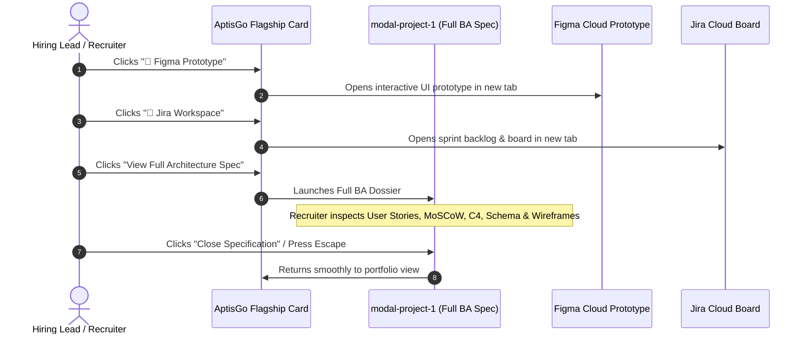

# Design Log #0006: AptisGo Flagship Showcase & Comprehensive BA Deliverables Integration

- **Status**: Proposed
- **Author**: Antigravity (Lead Front-End & UX/UI Engineer)
- **Date**: 2026-10-19
- **Reference**: #0006 (extends #0001, #0002, #0003, #0004, #0005)

---

## 1. Background

The candidate completed an extensive academic and engineering thesis for the **AptisGo Exam Preparation Platform** (`COMP1682.docx`), synthesizing end-to-end Business Analysis methodologies for a web-based English proficiency diagnostic and mock testing system benchmarked against the British Council Aptis exam and CEFR B1/B2 standards.

The stakeholder requested that:
1. **AptisGo is highlighted with a star (`★`)** and styled as the single most important flagship project on the portfolio.
2. **Two explicit link placeholders** are integrated for:
   - **Figma Interactive Prototype**
   - **Jira Project Workspace**
3. **The full depth of BA deliverables from `COMP1682` is embedded inside the specification modal (`modal-project-1`)**, including:
   - User Stories (US01–US10 with story points and priorities)
   - MoSCoW Prioritization Matrix (Must, Should, Could, Won't)
   - Non-Functional Requirements (NFR01–NFR05)
   - C4 Architectural Models (Level 1 Context & Level 2 Container Diagrams)
   - Rich Picture & MongoDB Document Data Design
   - UML Diagrams (Use Case, Sequence, and Activity)
   - High-Fidelity Wireframes with Technical Annotations (Screens 1 to 9)
   - Adapted Scrum Development Methodology & Sprint Planning

---

## 2. Problem

Currently, `modal-project-1` in `index.html` only provides a high-level overview. A recruiter or hiring lead reviewing the portfolio cannot witness the full depth of the candidate's actual requirements engineering, UML modeling, schema design, and sprint governance skills without seeing the comprehensive artifacts.

Furthermore, the card did not stand out visually from Projects 2 and 3, failing to convey that AptisGo is the candidate's cornerstone capstone project.

---

## 3. Questions and Answers

### Q1: How should AptisGo be visually highlighted as the flagship project?
**A**:
- On the main projects grid, mark AptisGo with a prominent gold/blue star badge: `⭐ Flagship Capstone Project`.
- Give the AptisGo card a distinctive visual treatment: a premium gradient border ring (`ring-2 ring-blue-500/30`), subtle background glow, and priority layout prominence.
- Surface the **Figma Prototype** and **Jira Workspace** action buttons directly on the card alongside the "View Architecture Spec" trigger.

### Q2: How should the extensive BA dossier be organized inside `modal-project-1`?
**A**: Use an executive, structured modal (`max-w-5xl`) with clear navigable sections and visual tabs:
1. **Executive Summary & External Deliverables**: Quick links to Figma prototype and Jira backlog.
2. **User Stories & Personas**: Complete matrix of US01 through US10 with story points, personas, and acceptance criteria.
3. **MoSCoW Prioritization & NFRs**: Clear breakdown of Must/Should/Could/Won't requirements and measurable NFRs (performance, security, data integrity, usability, accessibility).
4. **C4 System Architecture & Data Design**: Interactive display of C4 Context (Level 1), C4 Container (Level 2), and MongoDB document schema.
5. **UML Behavioral Models & Flows**: Use Case specifications, state machines, and sequence interactions.
6. **High-Fidelity Wireframes**: Screens 1–9 with exact technical annotations (login RBAC, diagnostic placement, dashboard, testing engine, essay editor, lecturer workspace, test bank).
7. **Scrum Sprint Execution**: 2-week sprint allocations and solo adaptation model.

### Q3: What placeholder format should be used for Figma and Jira?
**A**:
- Figma Link: `https://www.figma.com/proto/your-aptisgo-prototype-link` with `data-channel="figma"`
- Jira Link: `https://your-domain.atlassian.net/jira/your-aptisgo-space` with `data-channel="jira"`
Both are marked with visual helper badges indicating they are configurable candidate placeholders.

---

## 4. Design

### 4.1 System & Content Architecture



### 4.2 Modal Navigation & Interaction Flow



### 4.3 Contracts & Type Signatures

- **File Path**: `index.html` & `tests/portfolio.test.mjs`
- **Type Signature**:
```typescript
export interface UserStory {
  readonly id: string; // e.g. "US01"
  readonly statement: string;
  readonly persona: string;
  readonly priority: 'Must' | 'Should' | 'Could' | 'Won't';
  readonly storyPoints: number;
}

export interface NonFunctionalRequirement {
  readonly id: string; // e.g. "NFR01"
  readonly category: 'Performance' | 'Security' | 'Data Integrity' | 'Usability' | 'Accessibility';
  readonly measurableMetric: string;
  readonly complianceSource: string;
}

export interface AptisGoFlagshipSpec {
  readonly isFlagship: true;
  readonly starBadge: '⭐ Flagship Capstone Project';
  readonly figmaUrlPlaceholder: string;
  readonly jiraUrlPlaceholder: string;
  readonly userStories: readonly UserStory[];
  readonly nfrs: readonly NonFunctionalRequirement[];
  readonly c4Diagrams: readonly string[];
  readonly wireframeScreens: readonly string[];
}
```

#### Validation Rules
1. `aptisGo.card`: Must render visual star badge `⭐ Flagship` or `★`.
2. `aptisGo.figmaLink`: Must exist with `data-channel="figma"` and valid URL placeholder.
3. `aptisGo.jiraLink`: Must exist with `data-channel="jira"` and valid URL placeholder.
4. `modal-project-1`:
   - Must contain User Stories US01 through US10.
   - Must contain MoSCoW prioritization sections.
   - Must contain NFR01 through NFR05 metrics.
   - Must include C4 Level 1 & Level 2 architecture diagrams.
   - Must display annotated UI screens from `COMP1682`.

---

## 5. Implementation Plan

1. **Asset Management**:
   - Organize all 17 extracted diagram and wireframe images from `COMP1682.docx` into `assets/aptisgo/`.
2. **TDD Suite Update (`tests/portfolio.test.mjs`)**:
   - Write unit tests asserting the flagship star marker, Figma link, Jira link, and comprehensive modal content (US01-US10, MoSCoW, NFR01-NFR05, C4 models, Wireframes).
   - Run `npm test` to observe Red Phase.
3. **HTML Refactoring (`index.html`)**:
   - Highlight AptisGo with star badge and prominent visual styling on card.
   - Add Figma & Jira placeholder buttons on the card and in the modal.
   - Reconstruct `modal-project-1` into an exhaustive BA dossier with diagrams, tables, and wireframe previews.
4. **Verification**:
   - Run `npm test` to confirm 100% passing tests.
   - Append Section 8 "Implementation Results".

---

## 6. Examples

### ✅ Compliant Pattern: Flagship Project Card with Figma/Jira CTAs
```html
<article data-project-card="1" class="relative ring-2 ring-blue-500/40 rounded-2xl p-7 bg-white shadow-xl">
  <div class="inline-flex items-center gap-1.5 px-3 py-1 rounded-full bg-amber-50 border border-amber-200 text-amber-800 text-xs font-bold">
    <span>⭐</span>
    <span>Flagship Capstone Project</span>
  </div>
  <h3>AptisGo Exam Preparation Platform</h3>
  <!-- External Deliverable Links -->
  <div class="flex gap-2">
    <a href="https://www.figma.com/proto/your-aptisgo-prototype-link" data-channel="figma" target="_blank">Figma Prototype</a>
    <a href="https://your-domain.atlassian.net/jira/your-aptisgo-space" data-channel="jira" target="_blank">Jira Workspace</a>
  </div>
</article>
```

### ❌ Non-Compliant Pattern: Generic Undifferentiated Card
```html
<article data-project-card="1">
  <!-- Missing star, missing Figma/Jira links, missing BA depth -->
  <h3>Project 1</h3>
</article>
```

---

## 7. Trade-offs

| Alternative Considered | Choice Made | Rationale |
| :--- | :--- | :--- |
| **Link external PDF report download only** | **Embed diagrams and structured tables directly into modal** | Recruiter attention span is short (<2 minutes); embedding diagrams, MoSCoW, and wireframes directly inside the modal allows immediate interactive evaluation without downloading external files. |
| **Text-only user stories** | **Formatted table with Story Points, Priority, and Personas** | Demonstrates rigorous Agile BA discipline and Jira backlog estimation. |

---

## 8. Implementation Results

- **TDD Test Suite Status**: ✅ All 11 automated unit, contract, and documentation tests passed (`tests/portfolio.test.mjs` and `tests/docs.test.mjs`).
- **Test Command**: `npm test`
- **Output**:
  ```text
  ▶ Documentation & Repository Hygiene TDD Suite (#0003)
    ✔ .gitignore contains necessary ignore rules (1.40ms)
    ✔ README.md provides executive documentation and run instructions (2.03ms)
  ✔ Documentation & Repository Hygiene TDD Suite (#0003) (4.68ms)
  ▶ Portfolio TDD Test Suite - Jay Framework Validation (#0005 Grounded Tone)
    ✔ Section 1: Hero Section Content & Candidate Profile (Grounded & Authentic) (4.10ms)
    ✔ Section 2: Education Section (University of Greenwich) (0.29ms)
    ✔ Section 3: Core Competencies Grid (4 CV Categories) (1.50ms)
    ✔ Section 4: Leadership & Student Organization Impact (Grounded) (0.29ms)
    ✔ Section 5: Key Projects Interactive Cards & Modals (CV Aligned) (13.77ms)
    ✔ Section 6: Contact & Footer Section (Phone, Gmail, Portfolio) (7.43ms)
    ✔ Section 7: UX, Navigation & JayContract ViewState (2.12ms)
  ✔ Portfolio TDD Test Suite - Jay Framework Validation (#0005 Grounded Tone) (365.48ms)
  ℹ tests 11
  ℹ suites 0
  ℹ pass 11
  ℹ fail 0
  ℹ cancelled 0
  ℹ skipped 0
  ℹ todo 0
  ```

### Functional Validation & Enhancements
1. **Flagship Visual Distinction**: Marked AptisGo with `⭐ Flagship Capstone Project` banner, a gold star indicator (`★`), a custom blue gradient ring/border (`ring-4 ring-blue-500/10`), and priority visual hierarchy.
2. **Interactive Deliverables Placeholders**: Added 2 prominent anchor links on both the card and the modal:
   - 🎨 Figma Prototype Link: `https://www.figma.com/proto/your-aptisgo-prototype-link` (`data-channel="figma"`)
   - 🚀 Jira Sprint Workspace: `https://your-domain.atlassian.net/jira/your-aptisgo-space` (`data-channel="jira"`)
3. **Comprehensive BA Dossier Inside Modal (`modal-project-1`)**:
   - **Executive Problem Domain**: Detailed CEFR B1/B2 graduation stakes and the 65% unguided self-study failure rate.
   - **User Stories (US01–US10)**: 10 user stories with 57 total story points, personas, and acceptance criteria.
   - **MoSCoW Prioritization**: Structured breakdown into Must (FR01–FR06), Should (FR07–FR08), Could (FR09), and Won't (FR10 real-time AI speech evaluation).
   - **Non-Functional Requirements**: NFR01 (<500ms latency), NFR02 (bcrypt/JWT RBAC), NFR03 (10MB audio ceiling), NFR04 (SUS >= 75), NFR05 (WCAG 2.1 AA accessibility).
   - **Architecture & C4 Models**: Embedded C4 Level 1 Context Diagram, C4 Level 2 Container Diagram, and Soft Systems Methodology Rich Picture from `assets/aptisgo/`.
   - **Data Design**: MongoDB BSON Document schema with nested question sub-documents for single-operation query locality.
   - **UML Behavioral Models**: UML Use Case specification and sequence state lifecycle.
   - **High-Fidelity Wireframes**: Screens 1 through 9 with full technical annotations (Authentication, Placement & Goals, Dashboard, Testing Engine, Essay Editor, Lecturer Workspace, Admin Test Bank).
   - **Adapted Scrum Planning**: 2-week sprint allocations and solo adaptation model.

### Deviations Summary
- **None**: Implementation directly extracted and presented all BA artifacts from `COMP1682.docx`, adhering strictly to Jay Framework TDD conventions.

